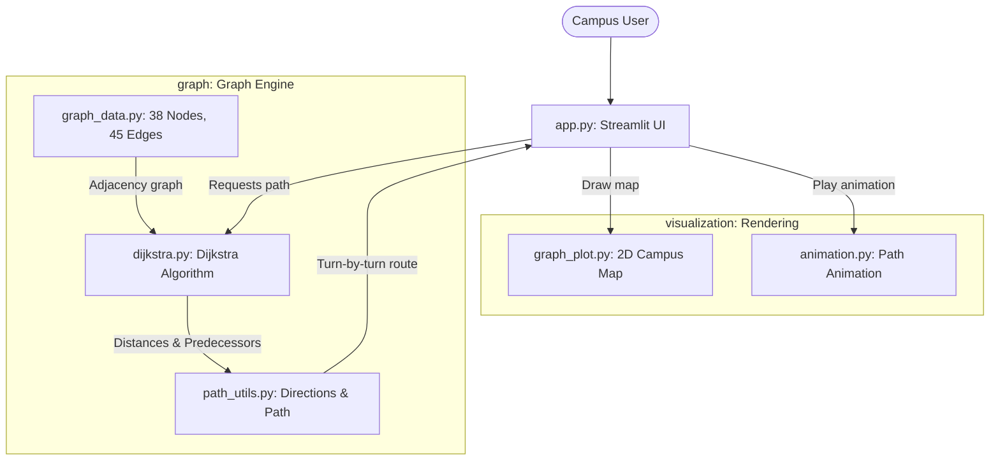
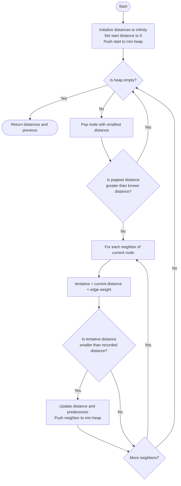
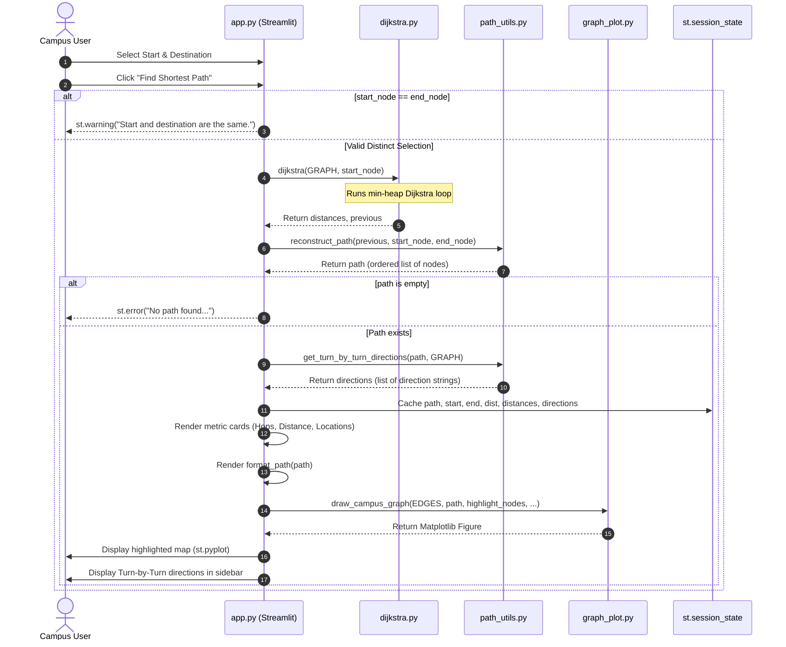

# DIU Campus Navigation System

A graph-based pathfinding and route visualization web application for Daffodil International University (DIU), powered by Dijkstra's algorithm.

[](https://www.python.org/)
[](https://streamlit.io/)
[](https://networkx.org/)
[](LICENSE)
[](https://diu-campus-navigator.streamlit.app/)

---

## 1. Overview

### The Problem
The permanent campus of Daffodil International University (DIU) in Birulia, Ashulia spans a vast physical area containing diverse academic complexes, departmental buildings, administrative offices, sporting grounds, dining centers, and multiple ingress/egress gates. For newly admitted students, visiting guests, faculty, and delivery services, navigating between distant campus landmarks on foot can lead to disorientation and inefficient routes.

### The Solution
The **DIU Campus Navigation System** models the pedestrian path network of the DIU campus as a weighted, undirected graph. Users select origin and destination points from an interactive interface, and the application calculates the mathematically shortest path using Dijkstra's algorithm. The system outputs exact walking distances (in meters), total path hops, turn-by-turn compass directions (e.g., North, South-East), an interactive 2D graph view, an animated step-by-step route traversal, and a comprehensive reachability matrix.

### Academic Context
This software was engineered as an academic term project for **CSE 213: Algorithms** in the Department of Computer Science and Engineering at Daffodil International University. The project bridges theoretical computer science paradigms with practical software engineering:
* Graph modeling and adjacency structure representation.
* Greedy optimization and priority queue-based shortest-path computation.
* Algorithmic complexity analysis (time and space trade-offs).
* Interactive visual explanation of algorithmic graph state transitions.

---

## 2. Live Demo & Interface

Access the deployed web application directly in your browser:

**Live Demo URL:** [https://diu-campus-navigator.streamlit.app/](https://diu-campus-navigator.streamlit.app/)

### Application Interface Layout

```
+-----------------------------------------------------------------------------------------+
|                                DIU Campus Navigator                                     |
| Find the shortest route between any two campus locations using Dijkstra's Algorithm.    |
+--------------------------+--------------------------------------------------------------+
| [ Route Planner ]        | [ Graph & Path ]  [ Step Animation ]  [ All Distances ]      |
| Start: [ Main Gate 1   ] |                                                              |
| Dest:  [ Mosque        ] | Metric Cards: [ 5 Hops ]  [ 80 m Total ]  [ 6 Locations ]    |
| [ Find Shortest Path ]   |                                                              |
|                          | Path: Main Gate 1 -> Admission Office -> ... -> Mosque       |
| [ Navigation Steps ]     |                                                              |
| 1. Walk North to ...     | Matplotlib 2D Campus Graph Canvas                            |
| 2. Walk East to ...      | (Path highlighted in neon green, nodes color-coded)          |
| 3. You have arrived!     |                                                              |
+--------------------------+--------------------------------------------------------------+
```

---

## 3. Features

* **Shortest Path Computation:** Executes an optimized implementation of Dijkstra's algorithm to determine the minimum walking distance between any two locations.
* **Compass-Based Turn-by-Turn Guidance:** Provides directional walking guidance (North, South, East, West, North-East, North-West, South-East, South-West) for every leg of the trip.
* **Key Route Metrics:** Computes and displays total path hops (`len(path) - 1`), cumulative walking distance in meters, and total locations visited.
* **Visual 2D Graph Display:** Renders the DIU campus graph via NetworkX and Matplotlib using coordinate layouts mirroring the physical campus map. Highlights origin (yellow), destination (red), intermediate path nodes (neon green), and unvisited nodes (sky blue).
* **Step-by-Step Path Animation:** Provides an animated traversal tab that steps through each node of the path at configurable intervals (0.8s) with a live progress bar, active node indicators, and dynamic frame redrawing.
* **Campus-Wide Distance Matrix:** Generates an interactive, sortable pandas table listing the shortest distance to every reachable node on campus from the selected origin, flagging nodes that lie on the active route.
* **Dark-Themed UI:** Clean interface with a dark palette (`#0F0F1A`, `#14142A`), high-contrast path accents, and responsive layout elements.

---

## 4. System Architecture

The application is structured into decoupled modules separating graph data, algorithmic logic, visualization rendering, and web UI orchestration.



---

## 5. Project Structure

```
campus-navigation-app-DIU/
├── app.py                      # Main Streamlit web application orchestrating UI, state, and rendering
├── mapdata.md                  # Reference specifications for campus POIs and directional graph connections
├── requirements.txt            # Python dependencies (streamlit, networkx, matplotlib, pandas)
├── LICENSE                     # MIT License specification
├── README.md                   # Comprehensive project documentation
├── graph/                      # Core graph modeling, algorithm, and path utility package
│   ├── __init__.py             # Graph package initialization file
│   ├── graph_data.py           # Campus nodes (38), weighted edges (45), and 2D spatial coordinates
│   ├── dijkstra.py             # Dijkstra's shortest-path algorithm using heapq min-heap priority queue
│   └── path_utils.py           # Path reconstruction, string formatting, and turn-by-turn direction generation
└── visualization/              # Graphical rendering and animation package
    ├── __init__.py             # Visualization package initialization file
    ├── graph_plot.py           # Campus network visualization using NetworkX and Matplotlib
    └── animation.py            # Progressive step-by-step path animation leveraging Streamlit placeholders
```

---

## 6. Graph Model

The DIU campus is modeled as an undirected, edge-weighted graph $G = (V, E, W)$:
* **Vertices ($V$):** Distinct points of interest, including gates, academic buildings, departments, recreational areas, and transport stations.
* **Edges ($E$):** Navigable pedestrian corridors and roadways connecting adjacent locations.
* **Weights ($W$):** Non-negative real numbers representing walking distances in meters.
* **Direction Attributes:** Each edge $(u, v)$ stores compass headings for directional traversal ($dir_{u \to v}$ and $dir_{v \to u}$, e.g., North, South, East, West, North-East, South-West, North-West, South-East).

### Graph Metrics
* **Total Nodes ($|V|$):** 38
* **Total Undirected Edges ($|E|$):** 45
* **Spatial Positions:** 38 coordinate pairs $(x, y)$ mapped to visual layout positions.

### Graph Data Sample

From [`graph/graph_data.py`](graph/graph_data.py):

```python
# Sample Node List (38 locations total)
NODES = [
    "Admission Office", "Bike Garage", "Boat Lake", "Bonomaya", "Bonomaya 2",
    "Central Jame Mosque", "Department of Civil Engineering",
    "Department of EEE", "DIU Garden", "DIU Health and Fitness Center",
    # ... 28 more locations ...
]

# Sample Edge Definitions: (node1, node2, weight_meters, dir_1_to_2, dir_2_to_1)
EDGES = [
    ("Admission Office", "Shaheed Minar", 20, "West", "East"),
    ("Admission Office", "Volleyball Court", 15, "East", "West"),
    ("Volleyball Court", "Green Garden", 15, "East", "West"),
    ("Green Garden", "LAB Academic Building", 20, "North-East", "South-West"),
    ("LAB Academic Building", "Central Jame Mosque", 15, "North-West", "South-East"),
    ("Main Gate 1", "Admission Office", 15, "North", "South"),
    # ... 39 more edges ...
]

# Sample 2D Coordinates for layout rendering
NODE_POSITIONS = {
    "Main Gate 1":                      (3.5,  0.0),
    "Admission Office":                 (4.0,  1.0),
    "Volleyball Court":                 (5.5,  1.5),
    "Green Garden":                     (6.5,  1.5),
    "LAB Academic Building":            (7.0,  2.5),
    "Central Jame Mosque":              (6.5,  3.5),
    # ... 32 more positions ...
}
```

The graph is loaded into memory as a nested adjacency dictionary:
```python
def build_graph(edges):
    graph = {node: {} for node in NODES}
    for u, v, w, dir_u_to_v, dir_v_to_u in edges:
        graph[u][v] = {'weight': w, 'direction': dir_u_to_v}
        graph[v][u] = {'weight': w, 'direction': dir_v_to_u}
    return graph
```

---

## 7. Shortest Path Algorithm

The shortest path is computed using Dijkstra's algorithm implemented in [`graph/dijkstra.py`](graph/dijkstra.py).

### Implementation Details
1. **Distance and Predecessor Initialization:**
   * Distances dictionary is initialized to infinity (`math.inf`) for all nodes.
   * Predecessors dictionary `previous` is initialized to `None` for all nodes.
   * Distance to start node is initialized to zero: `distances[start] = 0`.
2. **Min-Heap Priority Queue:**
   * Uses Python's standard `heapq` module storing tuples of `(cumulative_cost, node)`.
   * Initialized with `heap = [(0, start)]`.
3. **Lazy Heap Deletion (Stale Entry Filtering):**
   * When popping `(current_dist, current_node)`, the algorithm verifies:
     ```python
     if current_dist > distances[current_node]:
         continue  # Stale entry: a shorter path to this node was already found
     ```
   * If true, this queue entry represents an outdated distance superseded by an earlier shorter path relaxation, and is discarded in $O(1)$ time.
4. **Relaxation Condition:**
   * For each adjacent neighbor $v$ of `current_node` with edge weight $w$:
     ```python
     tentative = current_dist + weight
     if tentative < distances[neighbor]:
         distances[neighbor] = tentative
         previous[neighbor] = current_node
         heapq.heappush(heap, (tentative, neighbor))
     ```
   * The updated `(tentative, neighbor)` pair is pushed onto the min-heap.

### Algorithm Flowchart



### Worked Step-by-Step Example

Consider the following verified 5-node DIU campus subgraph:
* Nodes: `Main Gate 1`, `Admission Office`, `Shaheed Minar`, `Volleyball Court`, `Golf Yard`
* Edges:
  * (`Main Gate 1`, `Admission Office`, weight = 15)
  * (`Admission Office`, `Shaheed Minar`, weight = 20)
  * (`Admission Office`, `Volleyball Court`, weight = 15)
  * (`Shaheed Minar`, `Golf Yard`, weight = 25)
* Source: `Main Gate 1`

| Step | Extracted Node `(cost, u)` | Neighbor `v` | Edge Weight $w$ | Tentative Cost | Action / State Change | Min-Heap State After Step |
|:---:|:---|:---|:---:|:---:|:---|:---|
| **0** | *(Initialization)* | — | — | — | `dist[Main Gate 1] = 0`, all others $\infty$ | `[(0, Main Gate 1)]` |
| **1** | `(0, Main Gate 1)` | Admission Office | 15 | $0 + 15 = 15$ | Relax `Admission Office` ($15 < \infty$) | `[(15, Admission Office)]` |
| **2** | `(15, Admission Office)` | Main Gate 1<br/>Shaheed Minar<br/>Volleyball Court | 15<br/>20<br/>15 | $15+15=30$<br/>$15+20=35$<br/>$15+15=30$ | Ignored ($30 > 0$)<br/>Relax `Shaheed Minar` ($35 < \infty$)<br/>Relax `Volleyball Court` ($30 < \infty$) | `[(30, Volleyball Court), (35, Shaheed Minar)]` |
| **3** | `(30, Volleyball Court)` | Admission Office | 15 | $30 + 15 = 45$ | Ignored ($45 > 15$) | `[(35, Shaheed Minar)]` |
| **4** | `(35, Shaheed Minar)` | Admission Office<br/>Golf Yard | 20<br/>25 | $35+20=55$<br/>$35+25=60$ | Ignored ($55 > 15$)<br/>Relax `Golf Yard` ($60 < \infty$) | `[(60, Golf Yard)]` |
| **5** | `(60, Golf Yard)` | Shaheed Minar | 25 | $60 + 25 = 85$ | Ignored ($85 > 35$) | `[]` (Heap empty, terminate) |

**Final Shortest Path to Golf Yard:**
Backtracking via `previous`: `Golf Yard` $\leftarrow$ `Shaheed Minar` $\leftarrow$ `Admission Office` $\leftarrow$ `Main Gate 1`.
Reversed: `Main Gate 1` $\rightarrow$ `Admission Office` $\rightarrow$ `Shaheed Minar` $\rightarrow$ `Golf Yard` (Total distance: 60 meters).

### Asymptotic Complexity Analysis

* **Time Complexity:** $\mathcal{O}((|V| + |E|) \log |V|)$
  * Each node is popped from the min-heap at most once for processing: $|V| \times \mathcal{O}(\log |V|)$.
  * In the worst case, each edge relaxation pushes a new entry into the heap: $|E| \times \mathcal{O}(\log |V|)$.
  * Total running time: $\mathcal{O}(|V| \log |V| + |E| \log |V|) = \mathcal{O}((|V| + |E|) \log |V|)$.
  * On the DIU campus graph ($|V| = 38, |E| = 45$), the computation executes in less than 1 millisecond.
* **Space Complexity:** $\mathcal{O}(|V| + |E|)$
  * Adjacency dictionary: $\mathcal{O}(|V| + |E|)$ space.
  * Distance table (`distances`): $\mathcal{O}(|V|)$ space.
  * Predecessor map (`previous`): $\mathcal{O}(|V|)$ space.
  * Priority queue (`heap`): at most $\mathcal{O}(|E|)$ elements due to lazy duplicate pushes.

### Algorithm Comparison

| Algorithm | Edge Weights | Shortest Path Guarantee | Time Complexity | Space Complexity | Practical Campus Navigation Fit |
|:---|:---:|:---:|:---:|:---:|:---|
| **Dijkstra** *(Used)* | Non-negative ($w \ge 0$) | Yes | $\mathcal{O}((|V| + |E|) \log |V|)$ | $\mathcal{O}(|V| + |E|)$ | **Optimal choice:** Accurate distance minimization over non-uniform pedestrian paths without needing heuristic coordinates. |
| **Breadth-First Search (BFS)** | Unweighted / Uniform ($w = 1$) | Only for unweighted graphs | $\mathcal{O}(|V| + |E|)$ | $\mathcal{O}(|V|)$ | **Unsuitable:** Assumes every path between buildings has identical physical length; minimizes hop count rather than walking distance. |
| **Depth-First Search (DFS)** | Any | No | $\mathcal{O}(|V| + |E|)$ | $\mathcal{O}(|V|)$ | **Unsuitable:** Explores arbitrarily deep paths; does not produce shortest or cost-optimal routes. |
| **A\* Search** | Non-negative ($w \ge 0$) | Yes (with admissible $h(n)$) | $\mathcal{O}(|E|)$ best case, $\mathcal{O}((|V| + |E|) \log |V|)$ worst | $\mathcal{O}(|V| + |E|)$ | **Viable alternative:** Requires calibrated Euclidean or Haversine distance heuristics. For $|V|=38$, Dijkstra's execution overhead is already negligible. |

---

## 8. Runtime Execution Flow

The sequence diagram below models the operations triggered when a user clicks the **Find Shortest Path** button in the Streamlit application.



---

## 9. Tech Stack

| Technology / Library | Version | Project Purpose & Role |
|:---|:---:|:---|
| **Python** | `3.11+` | Core programming language for data structures and backend processing. |
| **Streamlit** | `^1.42.0` | Reactive web framework, state controller (`st.session_state`), and UI renderer. |
| **NetworkX** | `^3.0` | Graph data structure construction, edge mapping, and layout rendering utilities. |
| **Matplotlib** | `^3.8` | Custom rendering engine for dark-themed 2D campus graphs, styled labels, and legends. |
| **Pandas** | `^2.2` | Dataframe tabulation, sorting, and conditional styling of campus-wide distance tables. |
| **heapq** | Standard Library | Priority queue implementation underlying Dijkstra's algorithm. |

---

## 10. Installation & Local Setup

### Prerequisites
* Python 3.11 or higher installed on your system.
* Git installed.

### 1. Clone the Repository
```bash
git clone https://github.com/Erebo/campus-navigation-app-DIU.git
cd campus-navigation-app-DIU
```

### 2. Set Up a Virtual Environment

#### On Windows (PowerShell):
```powershell
python -m venv venv
.\venv\Scripts\Activate.ps1
```

#### On Windows (Command Prompt):
```cmd
python -m venv venv
.\venv\Scripts\activate.bat
```

#### On macOS & Linux:
```bash
python3 -m venv venv
source venv/bin/activate
```

### 3. Install Dependencies
```bash
pip install --upgrade pip
pip install -r requirements.txt
```

### 4. Run the Application
```bash
streamlit run app.py
```

The application will launch automatically in your default browser at `http://localhost:8501`.

---

## 11. Known Limitations & Roadmap

### Known Limitations
* **Schematic 2D Layout:** Coordinate positions in `NODE_POSITIONS` are mapped to an abstract 2D coordinate system matching the campus diagram layout rather than true geographic latitude/longitude coordinates.
* **Static Distance Estimations:** Edge weights represent estimated walking distances in meters based on static campus layout data; real-time factors (pedestrian congestion, terrain gradient, weather) are not accounted for.
* **Single-Plane Modeling:** High-rise structures (e.g., Knowledge Tower, LAB Academic Building) are modeled as single flat vertices without multi-floor indoor routing (stairs/elevators).
* **Synchronous Frame Redrawing:** The step-by-step animation generates and renders Matplotlib figures sequentially in the main thread, which can cause frame delay under resource-constrained environments.
* **Single Path Output:** The current implementation computes only the single shortest path without alternative route suggestions.

### Development Roadmap
- [ ] **Geographic Map Integration:** Migrate from static Matplotlib coordinates to interactive Leaflet/Mapbox maps with real GPS coordinates.
- [ ] **Multi-Floor Building Navigation:** Introduce subgraphs for multi-level buildings with vertical stairwell/elevator connections.
- [ ] **Accessible Routing Toggle:** Add route filtering for wheelchair accessibility (ramps vs. stairs).
- [ ] **A\* Search with Heuristic Weighting:** Implement A\* search with Haversine distance heuristics for benchmark comparison against Dijkstra.
- [ ] **Dynamic Campus Closures:** Allow administrative toggling of temporarily blocked pathways (e.g., construction, events).

---

## 12. Authors & Academic Credits

This project was created and submitted for **CSE 213: Algorithms** at Daffodil International University.

* **Mahadi Rahman Jihad**
* **Tartib Kaiser Munna**
* **Tasfia Mozumder Aupy**
* **Tahseen Alam**
* **Aminul Islam Rimon**

---

## 13. License & Acknowledgments

### License
This project is open-source software licensed under the **[MIT License](LICENSE)**.

### Acknowledgments
* Department of Computer Science and Engineering, **Daffodil International University (DIU)**.
* Faculty instructors and course moderators of **CSE 213: Algorithms**.
* The open-source developers behind **Streamlit**, **NetworkX**, and **Matplotlib**.
